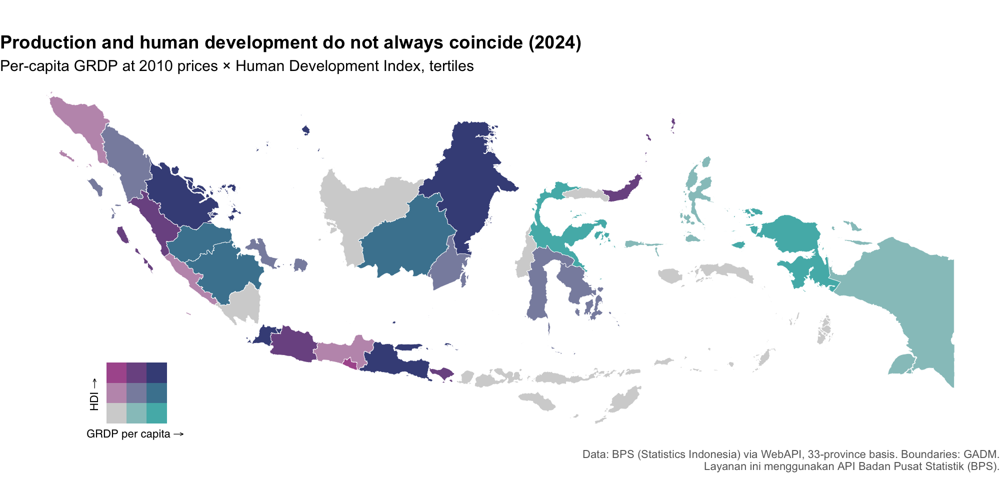
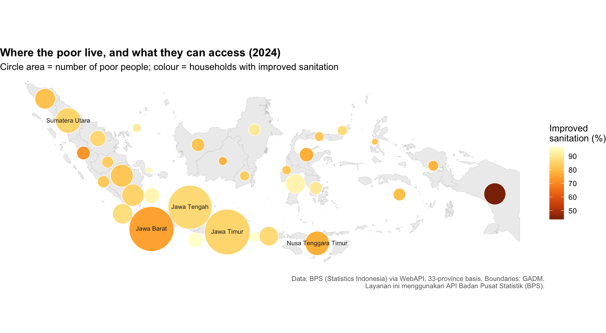
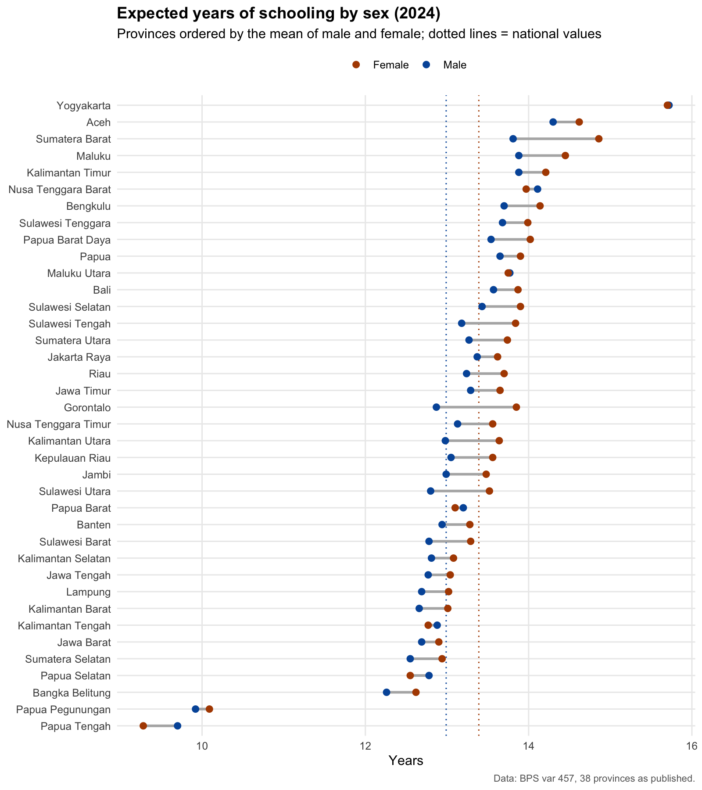
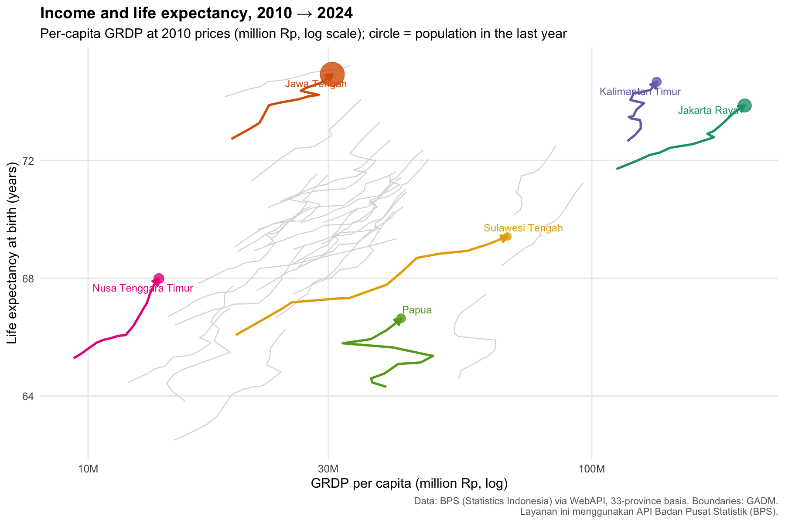
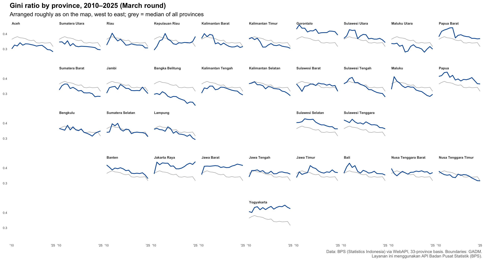
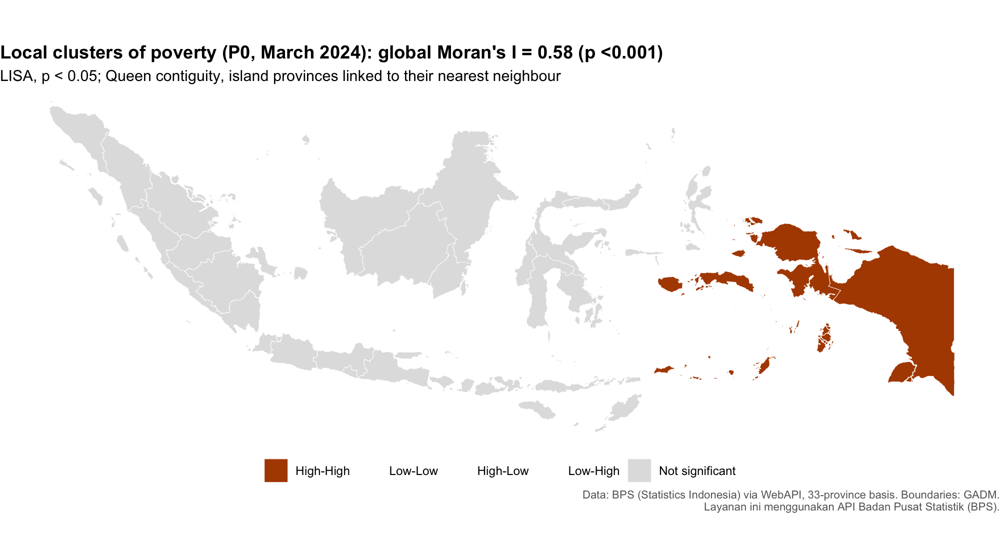

<!-- README.md is generated from README.Rmd. Edit this file, then knit. -->

# Regional disparities in Indonesia: six views of a provincial panel

Takafumi Kubota (Tama University)

These figures explore welfare and inequality across Indonesia’s
provinces, 2010–2025. All data come from Statistics Indonesia (Badan
Pusat Statistik, BPS) through its WebAPI, harmonised to the 33 provinces
of 2010 so that every year is comparable. They are the first step
towards spatial models of household welfare.

> Layanan ini menggunakan API Badan Pusat Statistik (BPS). (This service
> uses the API of Statistics Indonesia.)

## 1. Production and human development do not always coincide

<!-- -->

Per-capita GRDP (at 2010 prices) and the Human Development Index are
each split into thirds. Dark blue provinces are high on both; **teal
provinces produce a lot per head but rank low on human development** —
typically mining and resource provinces in the east. Pink provinces such
as Yogyakarta reach high human development with modest output.

## 2. Where the poor live

<!-- -->

Each province becomes a circle whose area is the number of poor people.
Most of Indonesia’s poor live on **Java**, even though Java’s poverty
*rates* are moderate. The darkest circle is Papua, where fewer than half
of households have improved sanitation.

## 3. Schooling expectations by sex

<!-- -->

In most provinces girls are now expected to stay in school **longer**
than boys. The exceptions are few (for example Nusa Tenggara Barat,
Kalimantan Tengah and several Papuan provinces), and the lowest levels
overall are in Papua Tengah and Papua Pegunungan.

## 4. Fifteen years of development

<!-- -->

Most provinces move up and to the right. Some paths stand out:
Kalimantan Timur gains life expectancy with little growth in output per
head, while Papua’s life expectancy has barely moved.

## 5. Inequality over time, laid out like the map

<!-- -->

The Gini ratio has fallen in most provinces since the early 2010s.
**Jakarta and Yogyakarta** are the exceptions, with inequality staying
high or rising.

## 6. Poverty clusters in space

<!-- -->

Poverty is strongly spatially autocorrelated (global Moran’s I = 0.58).
The significant **high–high cluster in eastern Indonesia** — Papua,
Papua Barat and Maluku — is where a spatial regression has to explain
why neighbours resemble each other.

## Data

| Indicator | BPS table | Selection |
|----|----|----|
| Population | static 1267; var 1886; var 2790 | census 2010, projections |
| Poverty rate (P0), number of poor | var 192, var 185 | March round |
| Gini ratio | var 98 | March round |
| GRDP | var 286 | 2010 constant prices |
| Human Development Index, life expectancy | var 494, var 414 | new method |
| Expected years of schooling | var 457 | by sex |
| Improved sanitation | var 834 | urban + rural |

Provinces created after 2010 (Kalimantan Utara; four new Papuan
provinces) are folded back into their parent provinces: counts are
summed, rates are averaged with population weights. How the data were
retrieved and checked is described in [How to get the
data](docs/how-to-get-the-data.md).

## Getting the data, and reproducing the figures

The data are **not** included in this repository. Instead, the code that
retrieves them is: with your own (free) BPS API key, one command fetches
every table, harmonises it to 33 provinces and checks it against the
national figures. The steps and the rules behind them are explained in
**[How to get the data](docs/how-to-get-the-data.md)**.

``` r
source("get_data.R")                  # retrieve from the BPS WebAPI into data/ (about 15 min)
source("make_figures.R")              # PNG files in figures/
rmarkdown::render("README.Rmd")       # or press Knit in RStudio
```

Data: BPS (Statistics Indonesia). Boundaries: GADM. Figures made with
ggplot2, sf, biscale, cartogram and spdep.
